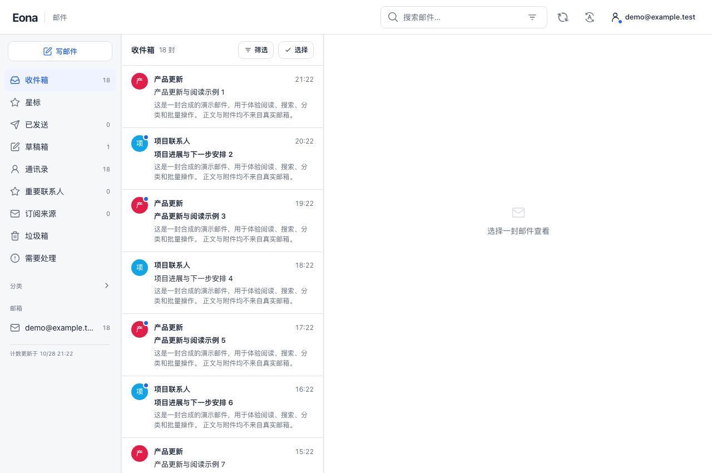
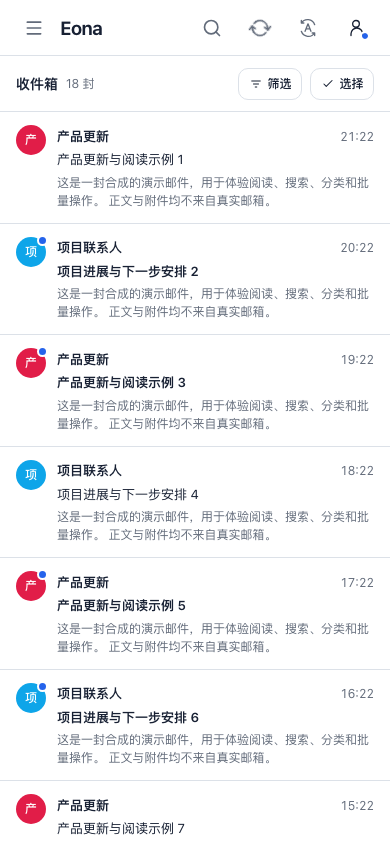

# Eona Mail

一个可独立部署的个人多邮箱工作台，支持桌面和移动端。数据存放在自己的 SQLite 数据库和文件目录中。

## 功能

- 接入 IMAP/SMTP，导入历史与新邮件，保留原件、正文和附件。
- 收件箱、星标、联系人、草稿、已发送、垃圾箱；搜索、即时筛选、批量操作。
- 可选双向同步已读、星标、垃圾箱恢复和草稿；Gmail 按邮件身份处理多标签。
- 本地密码登录或自选 OIDC，按用途授权的服务 API。
- 可选 AI 摘要、分类、翻译和通知接口；不配置也可运行邮箱。

Eona Mail 是邮箱客户端与归档工作台。使用者仍需提供已有邮箱及其 IMAP/SMTP 凭据；运行产品不要求注册 Cloudflare 或使用 Eona 的账号服务。目前一个实例对应一个拥有者，可配置多个邮箱。

## 界面

截图来自隔离合成演示。



<details>
<summary>手机界面</summary>



</details>

## 环境

Node.js 24.12 及以上的 24.x、Python 3.12。运行时 npm 依赖使用锁文件安装；IMAP 同步使用 Python 标准库。首次试用不需要真实邮箱、域名或第三方账号。

## 两分钟试用

[在线演示](https://demo-mail.eona.top) 使用当前对外发行批次。每个浏览器会话独立，数据为合成内容，不连接真实邮箱或外发。

```sh
npm ci --ignore-scripts --no-audit --no-fund
node product/cli.mjs init --mode demo --directory /tmp/eona-mail-demo --origin http://127.0.0.1:8799 --email demo@example.test
node product/cli.mjs serve --config /tmp/eona-mail-demo/mail.json
```

打开 <http://127.0.0.1:8799>。演示使用合成数据，浏览器会话互相隔离，不连接真实邮箱或外发。

## 接入自己的邮箱

按 [部署与升级](docs/SELF-HOSTING.md) 创建个人实例、设置密码、添加 IMAP/SMTP 和启动同步任务。配置、凭据与数据放在源码目录之外。

公开版本按批发布。安装或升级时选择明确的版本标签；个人实例初始化不会安装代码自动更新服务。每次升级先备份数据，停止旧进程，换代码后使用原数据根启动；代码回退与数据恢复分别处理。

## 开发与反馈

- [贡献与反馈](CONTRIBUTING.md)
- [服务 API 与鉴权](docs/API.md)
- [安全与数据边界](SECURITY.md)
- [产品职责](PRODUCT.md)
- [开发、测试与批次发布](docs/DEVELOPMENT.md)
- [第三方组件](THIRD_PARTY_NOTICES.md)

功能、交互、动效与连续使用的可复用缺陷进入产品回归。完整本地检查使用 `npm run check:local -- --output /new/evidence/path`；开发检查环境需要 Node 24、Python 3.12、锁定依赖及 Chromium/WebKit。

## 许可

Eona Mail 自有代码采用 [MIT](LICENSE)。第三方组件保留各自许可与版权声明。
